<p align="center">
  <a href="https://play.mint.gg">
    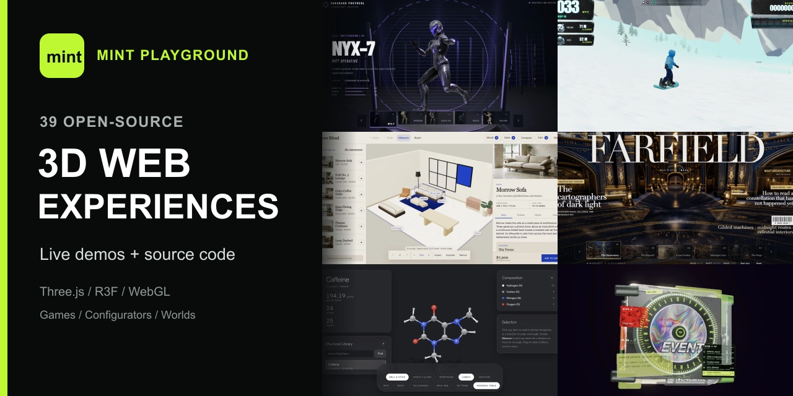
  </a>
</p>

<h1 align="center">Mint Playground</h1>

<p align="center">
  <strong>39 production-grade 3D web experiences, with live demos and source.</strong><br>
  Explore reusable patterns for browser games, product configurators, data visualization,<br>
  character animation, physics, audio, and Gaussian splats.
</p>

<p align="center">
  <a href="https://play.mint.gg"><strong>Play the demos</strong></a>
  ·
  <a href="#quick-start"><strong>Run one locally</strong></a>
  ·
  <a href="#browse-by-category"><strong>Browse by category</strong></a>
  ·
  <a href="CONTRIBUTING.md"><strong>Contribute</strong></a>
</p>

<p align="center">
  <a href="https://github.com/mintdotgg/mint-playground/stargazers"></a>
  <a href="https://github.com/mintdotgg/mint-playground/actions/workflows/validate.yml"></a>
  <a href="LICENSE"></a>
</p>

Every app is built with [Mint MCP](https://mcp.mint.gg/) as the 3D asset
pipeline and [Mint Three.js Skills](https://github.com/mintdotgg/mint-threejs-skills)
as the coding workflow. The source is organized as a pnpm workspace, with each
experience isolated in `experiences/<slug>` and linked to its deployed version.

## Start here

<table>
<tr>
  <td width="25%" valign="top">
    <a href="https://play.mint.gg/vanguard-protocol">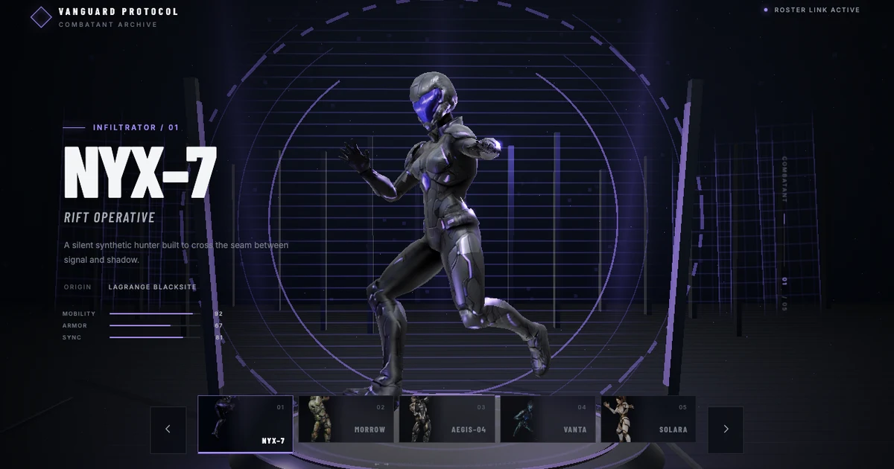</a>
    <strong>Character systems</strong><br>
    <sub><a href="experiences/vanguard-protocol">Vanguard Protocol</a> — animation, selection, cameras, and reactive staging.</sub>
  </td>
  <td width="25%" valign="top">
    <a href="https://play.mint.gg/breakline">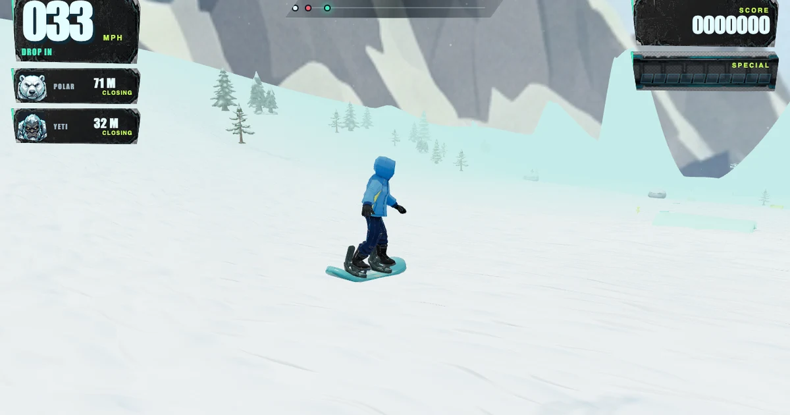</a>
    <strong>Game architecture</strong><br>
    <sub><a href="experiences/breakline">Breakline</a> — physics, input, camera rigs, tricks, HUD, and audio.</sub>
  </td>
  <td width="25%" valign="top">
    <a href="https://play.mint.gg/room-ritual">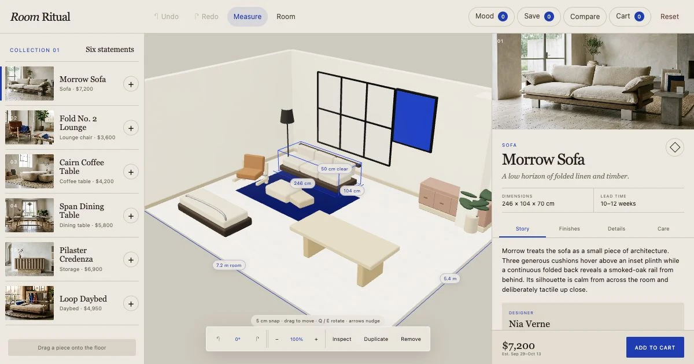</a>
    <strong>3D configurators</strong><br>
    <sub><a href="experiences/room-ritual">Room Ritual</a> — placement, materials, lighting, and persistent state.</sub>
  </td>
  <td width="25%" valign="top">
    <a href="https://play.mint.gg/impossible-places">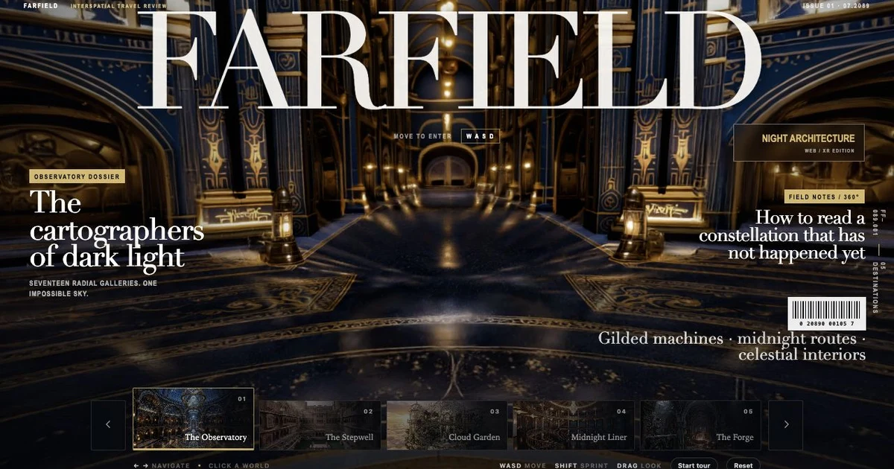</a>
    <strong>Gaussian splats</strong><br>
    <sub><a href="experiences/impossible-places">Impossible Places</a> — streamed worlds and cinematic exploration.</sub>
  </td>
</tr>
</table>

## Browse by category

| Category | Good places to begin |
| --- | --- |
| **Browser games** | [Breakline](experiences/breakline), [Mossbound](experiences/mossbound), [Reef Rivals](experiences/reef-rivals), [Genesis Grove Putt-Putt](experiences/mint-putt), [Flappy Bird 3D](experiences/flappy-bird-3d) |
| **Product and commerce** | [Common Form](experiences/common-form), [Room Ritual](experiences/room-ritual), [Sole Archive](experiences/sole-archive), [Seatline NYC](experiences/seatline-nyc) |
| **Data and education** | [Compound Visualization](experiences/compound-visualization), [Periodic Table 3D](experiences/periodic-table), [Financial City](experiences/financial-city), [SF Tennis Atlas](experiences/sf-tennis-atlas) |
| **Creative and editorial** | [Neon Relic](experiences/neon-relic), [CDX-2089 Music Player](experiences/cdx-2089-music-player), [Side One](experiences/side-one), [The Complete Shelf](experiences/complete-shelf) |
| **Worlds and simulation** | [Impossible Places](experiences/impossible-places), [Project Forge-5](experiences/project-forge-5), [Quadrotor Sandbox](experiences/quadrotor-sandbox), [Boulder Cove](experiences/boulder-cove) |

## Patterns you can reuse

| Pattern | Reference implementation |
| --- | --- |
| Character animation and selection | [`vanguard-protocol/src/showcase.ts`](experiences/vanguard-protocol/src/showcase.ts) |
| Third-person physics and camera systems | [`breakline/src/systems`](experiences/breakline/src/systems) |
| Configurator state and spatial placement | [`room-ritual/src`](experiences/room-ritual/src) |
| Audio-reactive Three.js visuals | [`cdx-2089-music-player/src/audio`](experiences/cdx-2089-music-player/src/audio) |
| Interactive scientific visualization | [`compound-visualization/src`](experiences/compound-visualization/src) |
| Product viewer and persistent cart | [`sole-archive/components/sole-archive`](experiences/sole-archive/components/sole-archive) |

## All experiences

<table>
<tr>
  <td width="220" valign="top">
    <a href="https://play.mint.gg/vanguard-protocol"></a>
    <h3>Vanguard Protocol</h3>
    <p><a href="https://github.com/mintdotgg/mint-playground/tree/main/experiences/vanguard-protocol">Code</a> · <a href="https://play.mint.gg/vanguard-protocol">Live demo</a></p>
  </td>
  <td valign="top">
    <p>A cinematic five-character combat roster with animated fighters and reactive tactical staging.</p>
    <p><sub>Three.js · Characters · Animation · Interactive</sub></p>
  </td>
</tr>
<tr>
  <td width="220" valign="top">
    <a href="https://play.mint.gg/helios-form">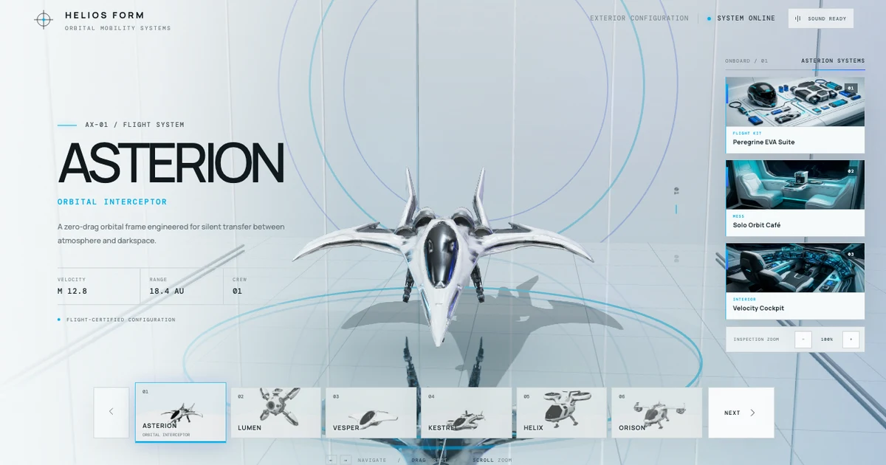</a>
    <h3>Helios Form</h3>
    <p><a href="https://github.com/mintdotgg/mint-playground/tree/main/experiences/helios-form">Code</a> · <a href="https://play.mint.gg/helios-form">Live demo</a></p>
  </td>
  <td valign="top">
    <p>A luminous orbital-vehicle showroom for inspecting six futuristic craft and their onboard systems.</p>
    <p><sub>Three.js · Vehicles · Showroom · Audio</sub></p>
  </td>
</tr>
<tr>
  <td width="220" valign="top">
    <a href="https://play.mint.gg/neon-relic">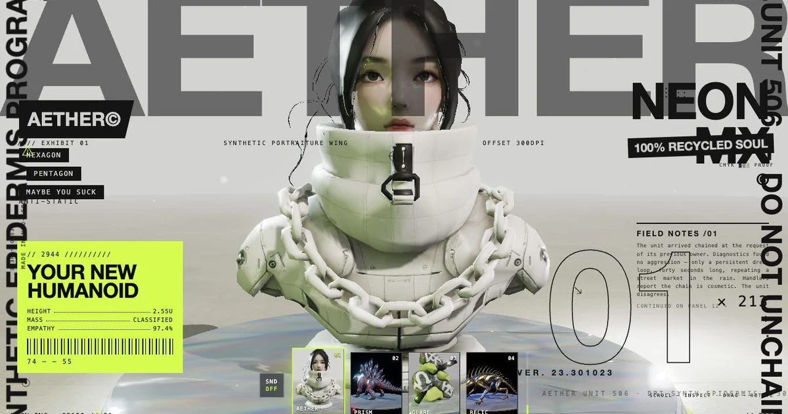</a>
    <h3>Neon Relic</h3>
    <p><a href="https://github.com/mintdotgg/mint-playground/tree/main/experiences/neon-relic">Code</a> · <a href="https://play.mint.gg/neon-relic">Live demo</a></p>
  </td>
  <td valign="top">
    <p>An interactive poster gallery where four sci-fi relics reshape the typography, lighting, materials, and sound.</p>
    <p><sub>Three.js · Editorial · Models · Audio</sub></p>
  </td>
</tr>
<tr>
  <td width="220" valign="top">
    <a href="https://play.mint.gg/impossible-places"></a>
    <h3>Impossible Places</h3>
    <p><a href="https://github.com/mintdotgg/mint-playground/tree/main/experiences/impossible-places">Code</a> · <a href="https://play.mint.gg/impossible-places">Live demo</a></p>
  </td>
  <td valign="top">
    <p>A cinematic travel magazine spanning five explorable Mint-generated Gaussian-splat worlds.</p>
    <p><sub>Three.js · Gaussian Splats · Worlds · Exploration</sub></p>
  </td>
</tr>
<tr>
  <td width="220" valign="top">
    <a href="https://play.mint.gg/mint-hoops">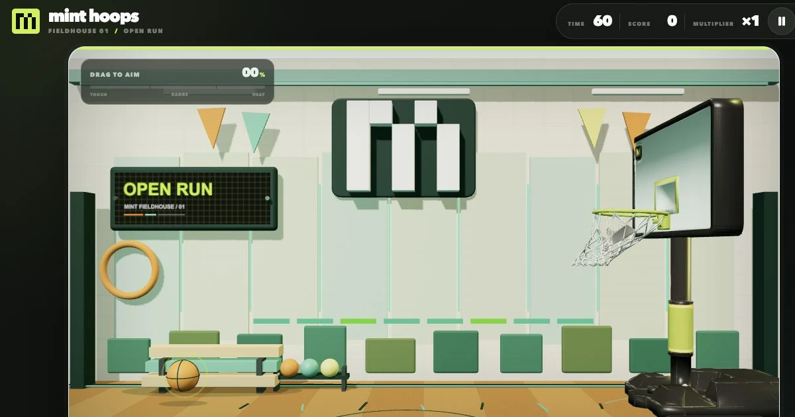</a>
    <h3>Mint Hoops</h3>
    <p><a href="https://github.com/mintdotgg/mint-playground/tree/main/experiences/mint-hoops">Code</a> · <a href="https://play.mint.gg/mint-hoops">Live demo</a></p>
  </td>
  <td valign="top">
    <p>A 60-second arcade basketball score attack with drag-to-shoot controls, combo multipliers, and a three-point finale.</p>
    <p><sub>Three.js · Basketball · Arcade · Game</sub></p>
  </td>
</tr>
<tr>
  <td width="220" valign="top">
    <a href="https://play.mint.gg/mossbound">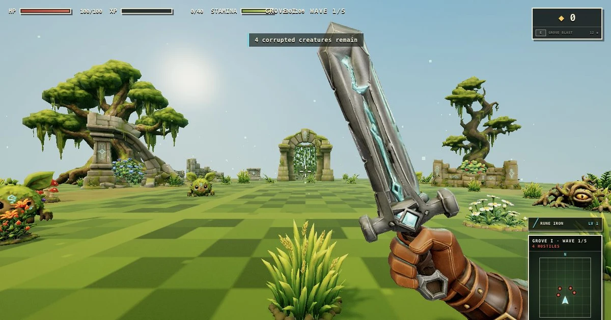</a>
    <h3>Mossbound</h3>
    <p><a href="https://github.com/mintdotgg/mint-playground/tree/main/experiences/mossbound">Code</a> · <a href="https://play.mint.gg/mossbound">Live demo</a></p>
  </td>
  <td valign="top">
    <p>A first-person fantasy melee run through five escalating waves of corrupted grove creatures, ending in a showdown with the Thornheart.</p>
    <p><sub>Three.js · Fantasy · First-Person · Action Game</sub></p>
  </td>
</tr>
<tr>
  <td width="220" valign="top">
    <a href="https://play.mint.gg/dynasty-index">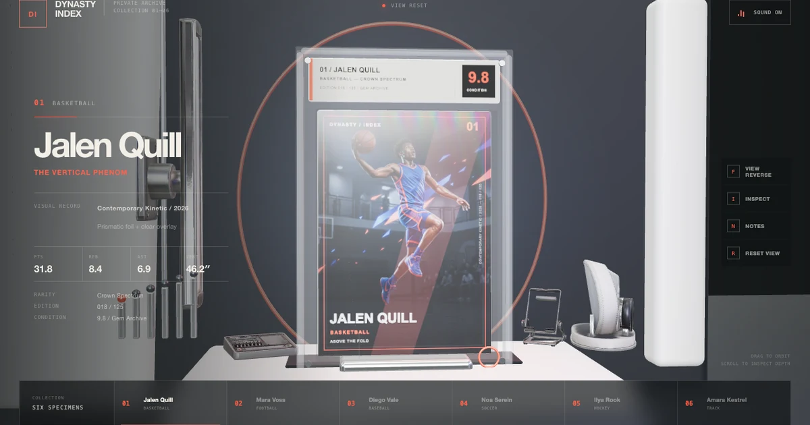</a>
    <h3>Dynasty Index</h3>
    <p><a href="https://github.com/mintdotgg/mint-playground/tree/main/experiences/dynasty-index">Code</a> · <a href="https://play.mint.gg/dynasty-index">Live demo</a></p>
  </td>
  <td valign="top">
    <p>An immersive collector vault for selecting and inspecting six fictional premium sports trading cards.</p>
    <p><sub>Three.js · Sports Cards · Collector · Interactive</sub></p>
  </td>
</tr>
<tr>
  <td width="220" valign="top">
    <a href="https://play.mint.gg/sf-tennis-atlas">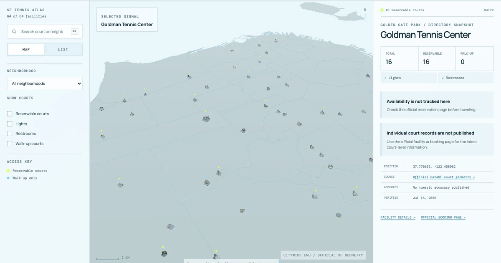</a>
    <h3>SF Tennis Atlas</h3>
    <p><a href="https://github.com/mintdotgg/mint-playground/tree/main/experiences/sf-tennis-atlas">Code</a> · <a href="https://play.mint.gg/sf-tennis-atlas">Live demo</a></p>
  </td>
  <td valign="top">
    <p>A source-aware 3D atlas for exploring all 64 official San Francisco public tennis facilities.</p>
    <p><sub>Three.js · Tennis · Civic Data · Interactive Map</sub></p>
  </td>
</tr>
<tr>
  <td width="220" valign="top">
    <a href="https://play.mint.gg/reef-rivals">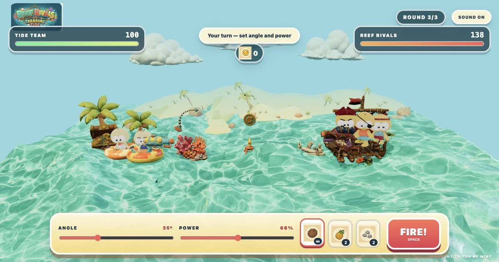</a>
    <h3>Reef Rivals: Treasure Tide</h3>
    <p><a href="https://github.com/mintdotgg/mint-playground/tree/main/experiences/reef-rivals">Code</a> · <a href="https://play.mint.gg/reef-rivals">Live demo</a></p>
  </td>
  <td valign="top">
    <p>A three-round tropical projectile battler where tube-riding heroes aim, charge, and outshoot an escalating pirate raft crew.</p>
    <p><sub>Three.js · Turn-Based · Projectile · Game</sub></p>
  </td>
</tr>
<tr>
  <td width="220" valign="top">
    <a href="https://play.mint.gg/cdx-2089-music-player">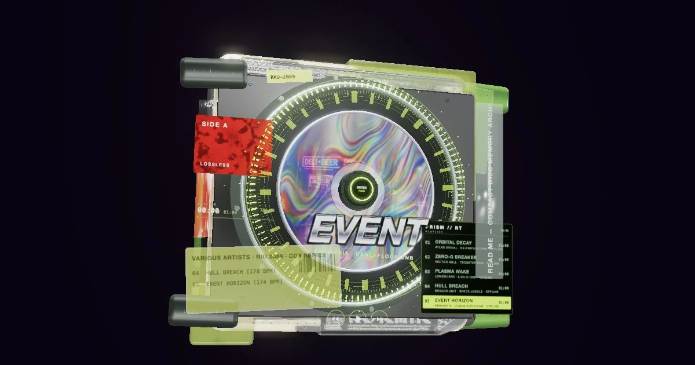</a>
    <h3>CDX-2089 Music Player</h3>
    <p><a href="https://github.com/mintdotgg/mint-playground/tree/main/experiences/cdx-2089-music-player">Code</a> · <a href="https://play.mint.gg/cdx-2089-music-player">Live demo</a></p>
  </td>
  <td valign="top">
    <p>A skin-adaptive 3D music player with five futuristic disc decks, audio-reactive visuals, and an unfolding dance floor.</p>
    <p><sub>Three.js · Music · Audio-Reactive · Interactive</sub></p>
  </td>
</tr>
<tr>
  <td width="220" valign="top">
    <a href="https://play.mint.gg/final-whistle">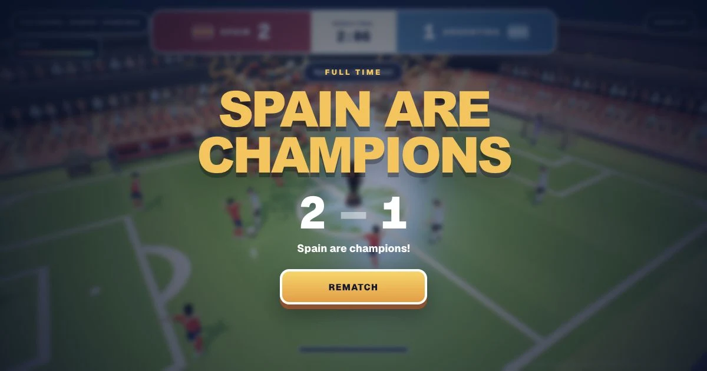</a>
    <h3>Final Whistle: Spain vs Argentina</h3>
    <p><a href="https://github.com/mintdotgg/mint-playground/tree/main/experiences/final-whistle">Code</a> · <a href="https://play.mint.gg/final-whistle">Live demo</a></p>
  </td>
  <td valign="top">
    <p>Lead Spain through a 150-second 3D arcade football final against Argentina with passing, tackles, charged shots, and golden-goal drama.</p>
    <p><sub>Three.js · Football · Arcade · Sports Game</sub></p>
  </td>
</tr>
<tr>
  <td width="220" valign="top">
    <a href="https://play.mint.gg/mint-putt">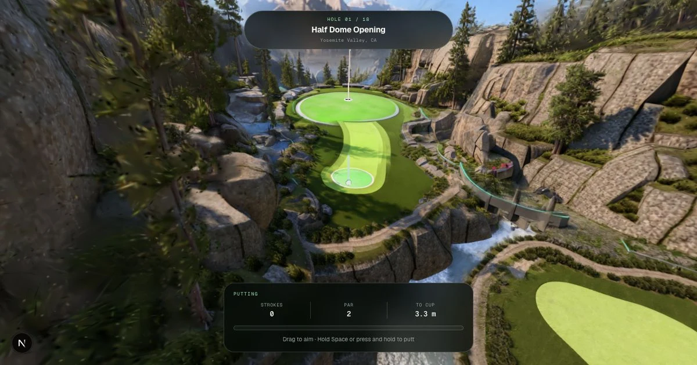</a>
    <h3>Genesis Grove Putt-Putt</h3>
    <p><a href="https://github.com/mintdotgg/mint-playground/tree/main/experiences/mint-putt">Code</a> · <a href="https://play.mint.gg/mint-putt">Live demo</a></p>
  </td>
  <td valign="top">
    <p>An 18-hole putting round through California-inspired Gaussian splat worlds, with drag-to-aim shots, touch controls, and a running scorecard.</p>
    <p><sub>React Three Fiber · SparkJS · Mini Golf · Game</sub></p>
  </td>
</tr>
<tr>
  <td width="220" valign="top">
    <a href="https://play.mint.gg/boulder-cove">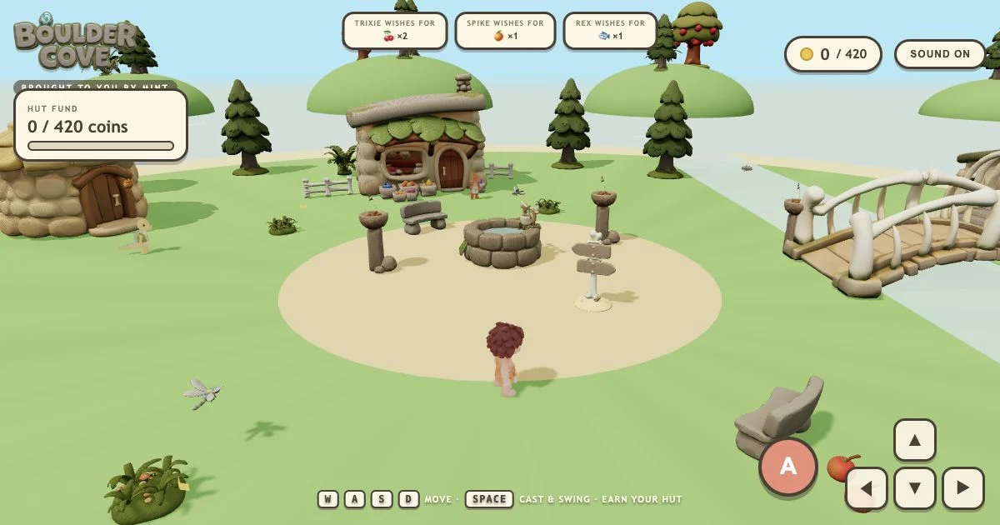</a>
    <h3>Boulder Cove</h3>
    <p><a href="https://github.com/mintdotgg/mint-playground/tree/main/experiences/boulder-cove">Code</a> · <a href="https://play.mint.gg/boulder-cove">Live demo</a></p>
  </td>
  <td valign="top">
    <p>A cozy prehistoric island life game where you gather, fish, catch bugs, plant trees, and help dinosaur neighbors earn your own boulder hut.</p>
    <p><sub>Three.js · SparkJS · Life Sim · Game</sub></p>
  </td>
</tr>
<tr>
  <td width="220" valign="top">
    <a href="https://play.mint.gg/orbit-week">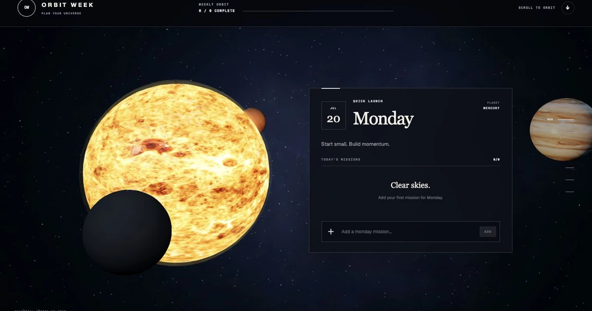</a>
    <h3>Orbit Week</h3>
    <p><a href="https://github.com/mintdotgg/mint-playground/tree/main/experiences/orbit-week">Code</a> · <a href="https://play.mint.gg/orbit-week">Live demo</a></p>
  </td>
  <td valign="top">
    <p>A cinematic 3D weekly planner where each day is a planet and every task becomes a mission you can add, complete, and carry through the week.</p>
    <p><sub>Three.js · React · Productivity · 3D Planner</sub></p>
  </td>
</tr>
<tr>
  <td width="220" valign="top">
    <a href="https://play.mint.gg/jimothys-backyard-dash">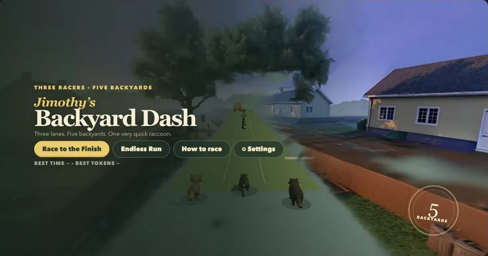</a>
    <h3>Jimothy’s Backyard Dash</h3>
    <p><a href="https://github.com/mintdotgg/mint-playground/tree/main/experiences/jimothys-backyard-dash">Code</a> · <a href="https://play.mint.gg/jimothys-backyard-dash">Live demo</a></p>
  </td>
  <td valign="top">
    <p>Guide Jimothy through a fast three-lane backyard race, dodging obstacles, collecting Moon Tokens, and battling two rivals across five streamed worlds.</p>
    <p><sub>Three.js · SparkJS · Arcade · Racing Game</sub></p>
  </td>
</tr>
<tr>
  <td width="220" valign="top">
    <a href="https://play.mint.gg/common-form">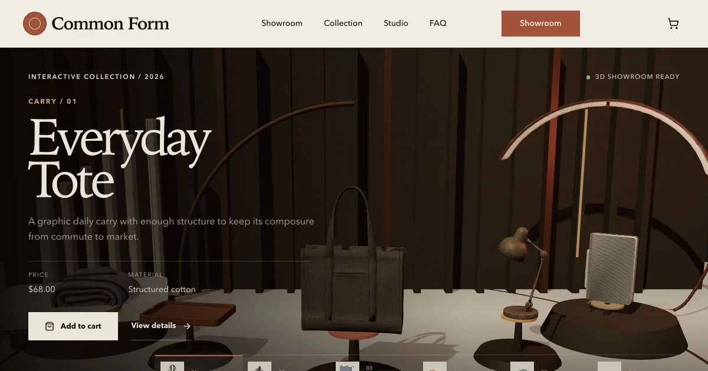</a>
    <h3>Common Form</h3>
    <p><a href="https://github.com/mintdotgg/mint-playground/tree/main/experiences/common-form">Code</a> · <a href="https://play.mint.gg/common-form">Live demo</a></p>
  </td>
  <td valign="top">
    <p>Explore six considered everyday objects in a warm interactive showroom, inspect them in 3D, and build a persistent demo cart.</p>
    <p><sub>Three.js · Next.js · E-commerce · 3D Showroom</sub></p>
  </td>
</tr>
<tr>
  <td width="220" valign="top">
    <a href="https://play.mint.gg/room-ritual"></a>
    <h3>Room Ritual</h3>
    <p><a href="https://github.com/mintdotgg/mint-playground/tree/main/experiences/room-ritual">Code</a> · <a href="https://play.mint.gg/room-ritual">Live demo</a></p>
  </td>
  <td valign="top">
    <p>Arrange six statement furniture pieces in a soft-brutalist loft, customize finishes and lighting, and save, compare, or cart room plans.</p>
    <p><sub>Three.js · React · Configurator · Interior Design</sub></p>
  </td>
</tr>
<tr>
  <td width="220" valign="top">
    <a href="https://play.mint.gg/sole-archive">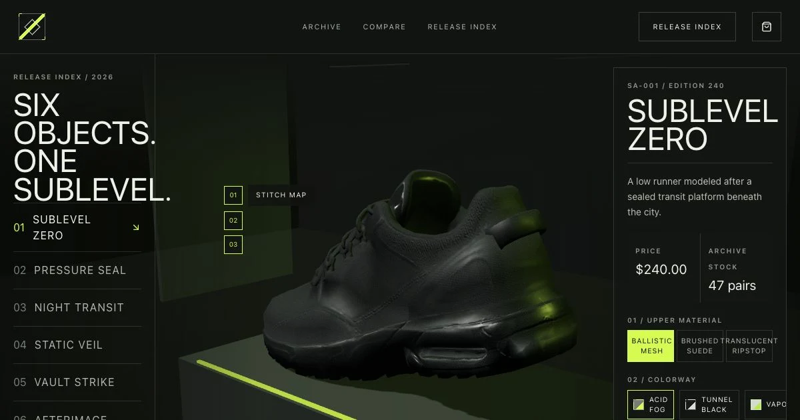</a>
    <h3>Sole Archive</h3>
    <p><a href="https://github.com/mintdotgg/mint-playground/tree/main/experiences/sole-archive">Code</a> · <a href="https://play.mint.gg/sole-archive">Live demo</a></p>
  </td>
  <td valign="top">
    <p>Inspect and configure six fictional sneakers in an underground boutique with exploded materials, comparison, wishlist, sizing, and a persistent demo cart.</p>
    <p><sub>Three.js · Next.js · Configurator · E-commerce</sub></p>
  </td>
</tr>
<tr>
  <td width="220" valign="top">
    <a href="https://play.mint.gg/seatline-nyc">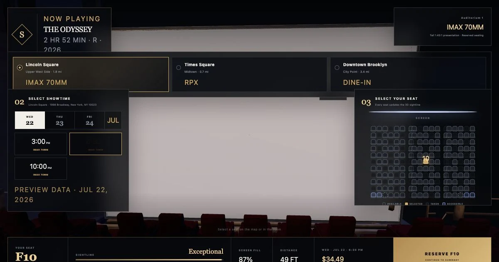</a>
    <h3>Seatline NYC</h3>
    <p><a href="https://github.com/mintdotgg/mint-playground/tree/main/experiences/seatline-nyc">Code</a> · <a href="https://play.mint.gg/seatline-nyc">Live demo</a></p>
  </td>
  <td valign="top">
    <p>Choose a New York theater, showtime, and seat, then preview the 3D screen angle and sightline before opening the venue’s live listing.</p>
    <p><sub>Three.js · Next.js · Seat Preview · Ticketing</sub></p>
  </td>
</tr>
<tr>
  <td width="220" valign="top">
    <a href="https://play.mint.gg/elemental-chess">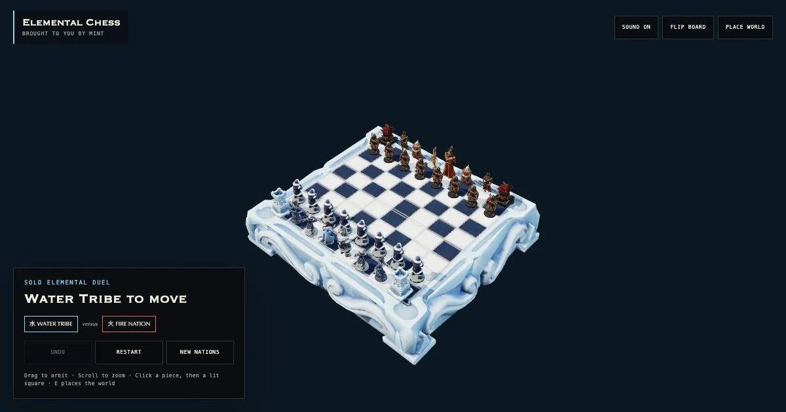</a>
    <h3>Elemental Chess</h3>
    <p><a href="https://github.com/mintdotgg/mint-playground/tree/main/experiences/elemental-chess">Code</a> · <a href="https://play.mint.gg/elemental-chess">Live demo</a></p>
  </td>
  <td valign="top">
    <p>Choose Water, Earth, Fire, or Air, face a rival, and play a complete cinematic 3D chess match in a Mint-authored elemental world.</p>
    <p><sub>Next.js · Three.js · Chess · Strategy</sub></p>
  </td>
</tr>
<tr>
  <td width="220" valign="top">
    <a href="https://play.mint.gg/memory-constellation">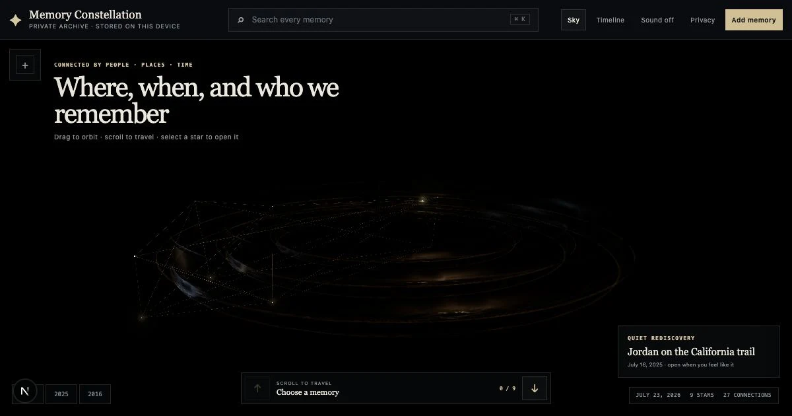</a>
    <h3>Memory Constellation</h3>
    <p><a href="https://github.com/mintdotgg/mint-playground/tree/main/experiences/memory-constellation">Code</a> · <a href="https://play.mint.gg/memory-constellation">Live demo</a></p>
  </td>
  <td valign="top">
    <p>Capture private memories locally, explore their connections as a 3D constellation, and revisit every moment in an accessible timeline.</p>
    <p><sub>Next.js · Three.js · Local-First · Memory Archive</sub></p>
  </td>
</tr>
<tr>
  <td width="220" valign="top">
    <a href="https://play.mint.gg/pogo-man">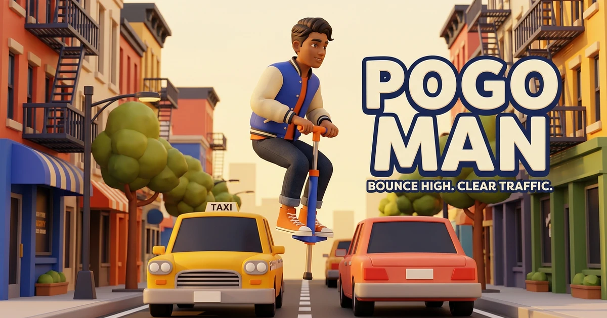</a>
    <h3>Pogo Man</h3>
    <p><a href="https://github.com/mintdotgg/mint-playground/tree/main/experiences/pogo-man">Code</a> · <a href="https://play.mint.gg/pogo-man">Live demo</a></p>
  </td>
  <td valign="top">
    <p>Charge double jumps to clear city traffic, build combos, and chase a high score in a one-button 3D arcade run.</p>
    <p><sub>Vinext · Three.js · Arcade · Runner</sub></p>
  </td>
</tr>
<tr>
  <td width="220" valign="top">
    <a href="https://play.mint.gg/robot-store">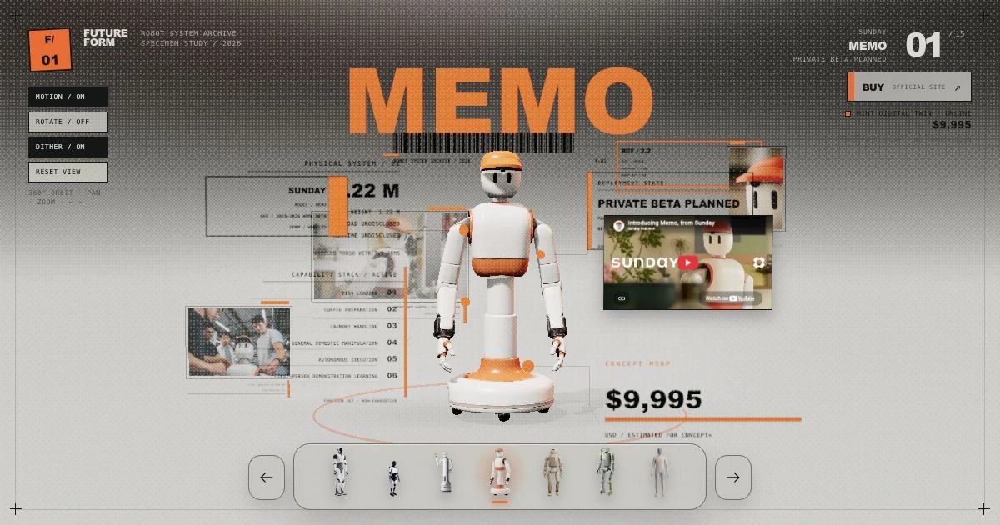</a>
    <h3>Future Form: Robot Store</h3>
    <p><a href="https://github.com/mintdotgg/mint-playground/tree/main/experiences/robot-store">Code</a> · <a href="https://play.mint.gg/robot-store">Live demo</a></p>
  </td>
  <td valign="top">
    <p>Explore an editorial 3D archive of 15 humanoid robots, orbit each digital twin, and compare their capabilities.</p>
    <p><sub>three.js · robots · catalog · interactive</sub></p>
  </td>
</tr>
<tr>
  <td width="220" valign="top">
    <a href="https://play.mint.gg/breakline"></a>
    <h3>Breakline</h3>
    <p><a href="https://github.com/mintdotgg/mint-playground/tree/main/experiences/breakline">Code</a> · <a href="https://play.mint.gg/breakline">Live demo</a></p>
  </td>
  <td valign="top">
    <p>Carve a 1.8 km mountain, chain tricks and grinds, and stay ahead of a Yeti and polar bear in a third-person arcade snowboarding chase.</p>
    <p><sub>Three.js · Snowboarding · Arcade · Sports Game · Rapier</sub></p>
  </td>
</tr>
<tr>
  <td width="220" valign="top">
    <a href="https://play.mint.gg/four-fields">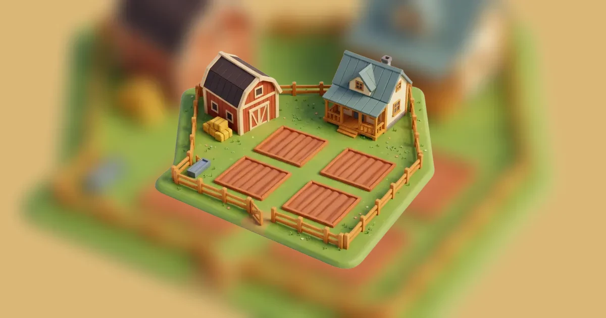</a>
    <h3>Four Fields</h3>
    <p><a href="https://github.com/mintdotgg/mint-playground/tree/main/experiences/four-fields">Code</a> · <a href="https://play.mint.gg/four-fields">Live demo</a></p>
  </td>
  <td valign="top">
    <p>Harvest corn, potatoes, tomatoes, and strawberries across four timed plots in a warm storybook miniature farm.</p>
    <p><sub>React · Three.js · Farming · Arcade</sub></p>
  </td>
</tr>
<tr>
  <td width="220" valign="top">
    <a href="https://play.mint.gg/financial-city">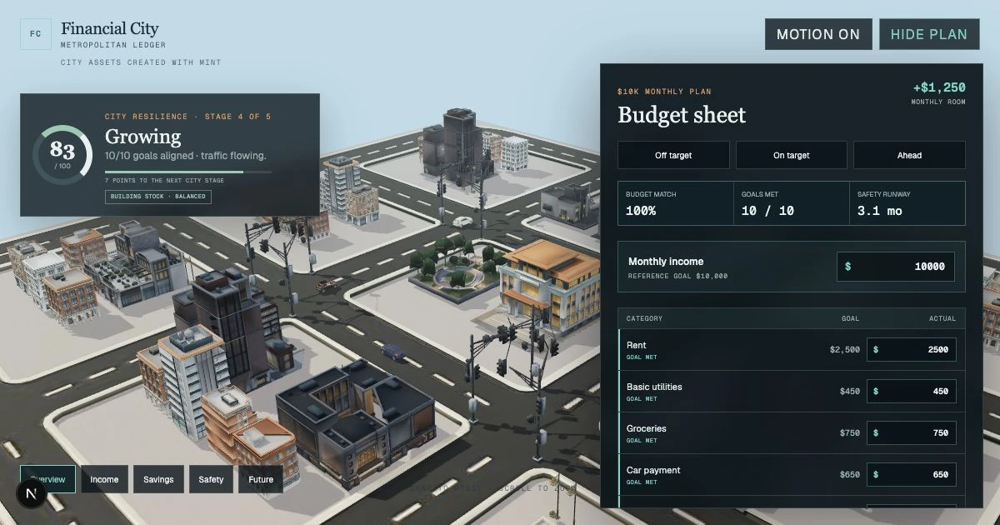</a>
    <h3>Financial City</h3>
    <p><a href="https://github.com/mintdotgg/mint-playground/tree/main/experiences/financial-city">Code</a> · <a href="https://play.mint.gg/financial-city">Live demo</a></p>
  </td>
  <td valign="top">
    <p>Shape a private monthly budget and watch traffic, civic services, construction pressure, and forty city blocks respond in a living miniature metropolis.</p>
    <p><sub>Next.js · Three.js · Personal Finance · Simulation · Data Visualization</sub></p>
  </td>
</tr>
<tr>
  <td width="220" valign="top">
    <a href="https://play.mint.gg/complete-shelf">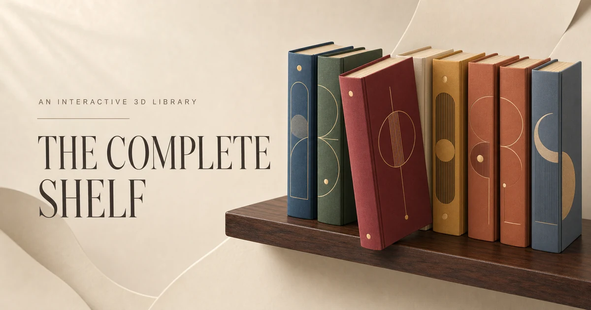</a>
    <h3>The Complete Shelf</h3>
    <p><a href="https://github.com/mintdotgg/mint-playground/tree/main/experiences/complete-shelf">Code</a> · <a href="https://play.mint.gg/complete-shelf">Live demo</a></p>
  </td>
  <td valign="top">
    <p>Browse nineteen procedural hardcovers on a continuous 3D shelf, then pull any volume forward to orbit, zoom, and inspect its editorial details.</p>
    <p><sub>Three.js · Books · Editorial · Interaction · Showcase</sub></p>
  </td>
</tr>
<tr>
  <td width="220" valign="top">
    <a href="https://play.mint.gg/kirby-smash">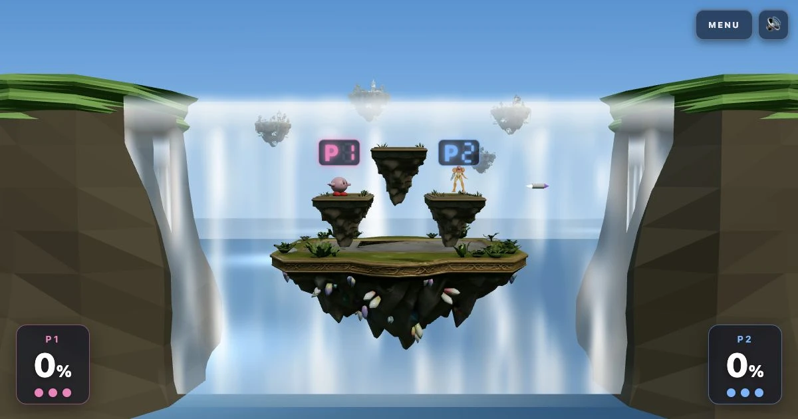</a>
    <h3>Kirby Smash</h3>
    <p><a href="https://github.com/mintdotgg/mint-playground/tree/main/experiences/kirby-smash">Code</a> · <a href="https://play.mint.gg/kirby-smash">Live demo</a></p>
  </td>
  <td valign="top">
    <p>Battle across three floating arenas in a 2.5D platform fighter with four selectable combatants, local two-player or CPU matches, percent damage, stocks, and Smash-style knockback.</p>
    <p><sub>Three.js · Platform Fighter · Local Multiplayer · Combat · Arcade</sub></p>
  </td>
</tr>
<tr>
  <td width="220" valign="top">
    <a href="https://play.mint.gg/compound-visualization">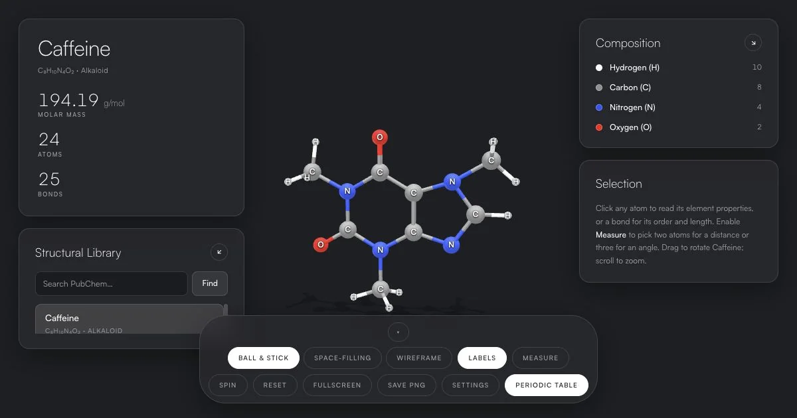</a>
    <h3>Compound Visualization</h3>
    <p><a href="https://github.com/mintdotgg/mint-playground/tree/main/experiences/compound-visualization">Code</a> · <a href="https://play.mint.gg/compound-visualization">Live demo</a></p>
  </td>
  <td valign="top">
    <p>Explore more than 40 molecules and crystals, switch rendering styles, inspect atoms and bonds, measure geometry, and search PubChem.</p>
    <p><sub>Three.js · Chemistry · Data Visualization · Education</sub></p>
  </td>
</tr>
<tr>
  <td width="220" valign="top">
    <a href="https://play.mint.gg/forgotten-experiment">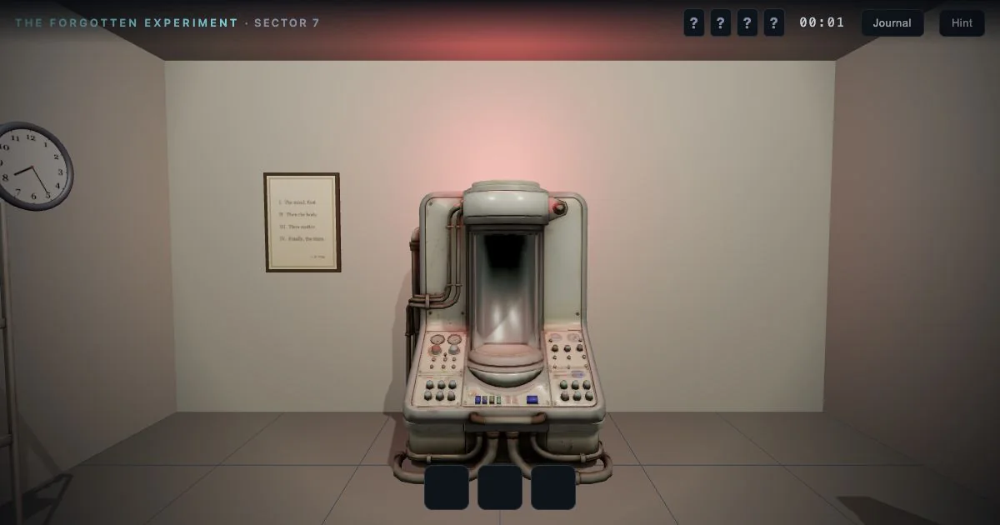</a>
    <h3>The Forgotten Experiment</h3>
    <p><a href="https://github.com/mintdotgg/mint-playground/tree/main/experiences/forgotten-experiment">Code</a> · <a href="https://play.mint.gg/forgotten-experiment">Live demo</a></p>
  </td>
  <td valign="top">
    <p>Search two abandoned laboratory rooms, collect and equip tools, solve layered evidence puzzles, and unlock Dr. Elias Vale&#39;s experiment.</p>
    <p><sub>Three.js · Escape Room · Puzzle · First-Person</sub></p>
  </td>
</tr>
<tr>
  <td width="220" valign="top">
    <a href="https://play.mint.gg/periodic-table">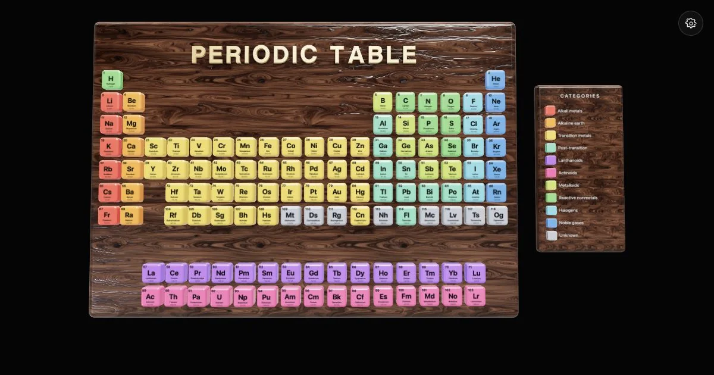</a>
    <h3>Periodic Table 3D</h3>
    <p><a href="https://github.com/mintdotgg/mint-playground/tree/main/experiences/periodic-table">Code</a> · <a href="https://play.mint.gg/periodic-table">Live demo</a></p>
  </td>
  <td valign="top">
    <p>Browse all 118 elements on a tactile 3D table, open any tile, and orbit an animated atom surrounded by detailed scientific properties.</p>
    <p><sub>Three.js · Chemistry · Education · Interactive</sub></p>
  </td>
</tr>
<tr>
  <td width="220" valign="top">
    <a href="https://play.mint.gg/side-one">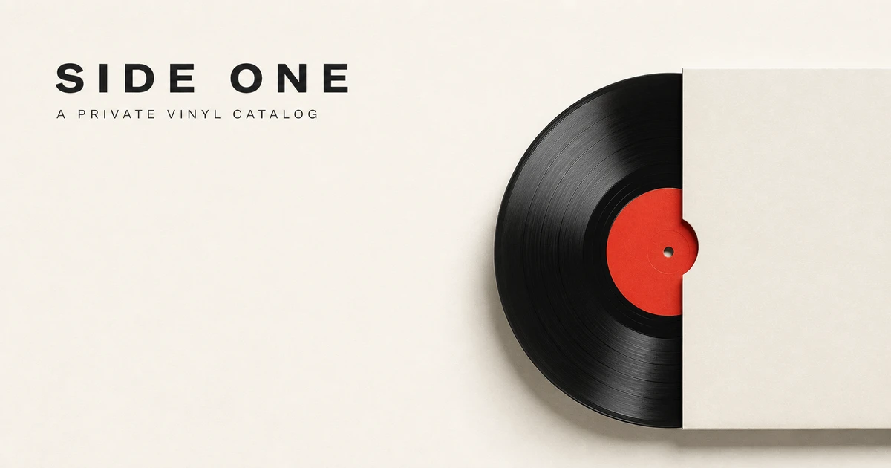</a>
    <h3>Side One</h3>
    <p><a href="https://github.com/mintdotgg/mint-playground/tree/main/experiences/side-one">Code</a> · <a href="https://play.mint.gg/side-one">Live demo</a></p>
  </td>
  <td valign="top">
    <p>Browse seven landmark releases across nine pressings, inspect every sleeve and track list, and cue a record on a configurable 3D turntable.</p>
    <p><sub>Next.js · Three.js · Music · Interactive</sub></p>
  </td>
</tr>
<tr>
  <td width="220" valign="top">
    <a href="https://play.mint.gg/dead-reckoning">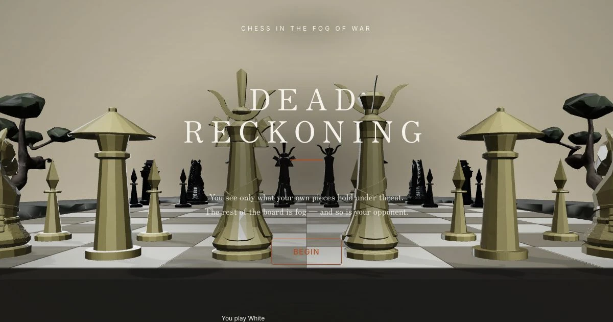</a>
    <h3>Dead Reckoning</h3>
    <p><a href="https://github.com/mintdotgg/mint-playground/tree/main/experiences/dead-reckoning">Code</a> · <a href="https://play.mint.gg/dead-reckoning">Live demo</a></p>
  </td>
  <td valign="top">
    <p>Play a complete 3D chess match where fog reveals only squares your pieces attack while a greedy AI moves unseen.</p>
    <p><sub>Next.js · React Three Fiber · Chess · Strategy</sub></p>
  </td>
</tr>
<tr>
  <td width="220" valign="top">
    <a href="https://play.mint.gg/project-forge-5">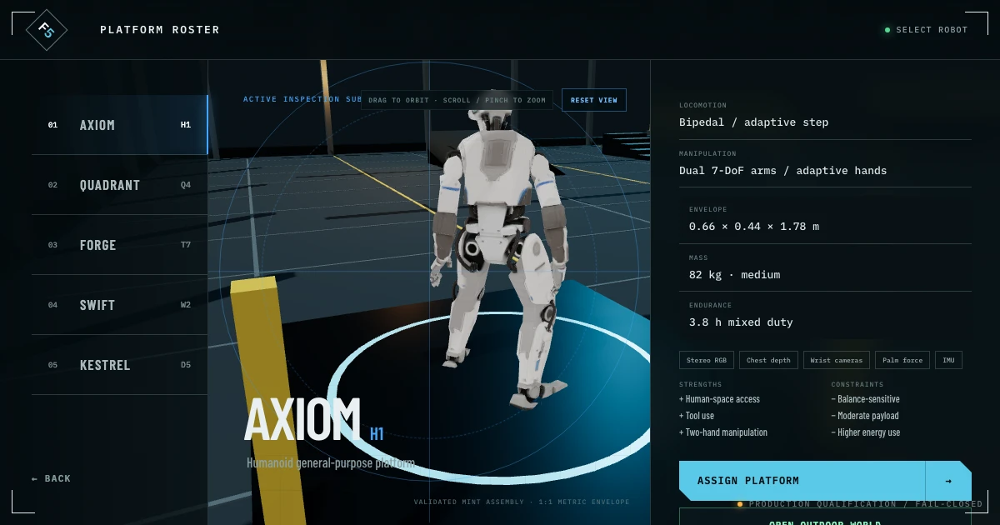</a>
    <h3>Project Forge-5</h3>
    <p><a href="https://github.com/mintdotgg/mint-playground/tree/main/experiences/project-forge-5">Code</a> · <a href="https://play.mint.gg/project-forge-5">Live demo</a></p>
  </td>
  <td valign="top">
    <p>Command five specialized robots through indoor qualification missions and an outdoor physics sandbox.</p>
    <p><sub>threejs · robotics · simulation · physics · sparkjs</sub></p>
  </td>
</tr>
<tr>
  <td width="220" valign="top">
    <a href="https://play.mint.gg/flappy-bird-3d">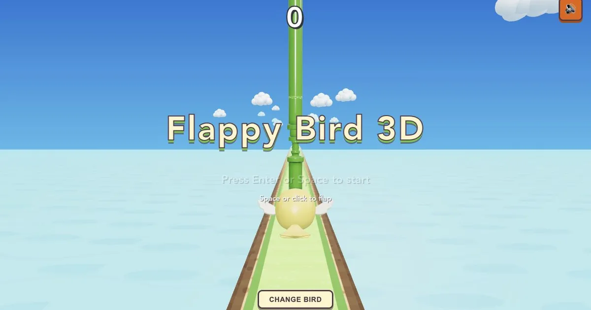</a>
    <h3>Flappy Bird 3D</h3>
    <p><a href="https://github.com/mintdotgg/mint-playground/tree/main/experiences/flappy-bird-3d">Code</a> · <a href="https://play.mint.gg/flappy-bird-3d">Live demo</a></p>
  </td>
  <td valign="top">
    <p>Fly a selectable 3D bird down an endless ocean causeway, flapping through randomized pipe gaps for a high score.</p>
    <p><sub>threejs · arcade · endless-runner · physics · game</sub></p>
  </td>
</tr>
<tr>
  <td width="220" valign="top">
    <a href="https://play.mint.gg/sleeping-snorlax">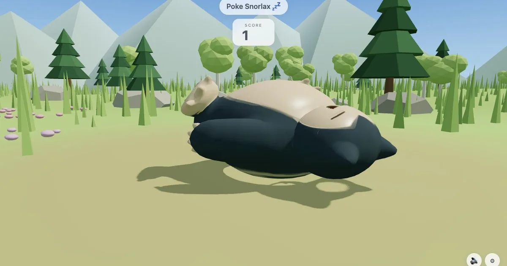</a>
    <h3>Sleeping Snorlax</h3>
    <p><a href="https://github.com/mintdotgg/mint-playground/tree/main/experiences/sleeping-snorlax">Code</a> · <a href="https://play.mint.gg/sleeping-snorlax">Live demo</a></p>
  </td>
  <td valign="top">
    <p>Poke a peacefully sleeping Snorlax to trigger escalating procedural reactions, combos, wake-ups, and permanent growth.</p>
    <p><sub>threejs · character · interaction · procedural-animation · audio</sub></p>
  </td>
</tr>
<tr>
  <td width="220" valign="top">
    <a href="https://play.mint.gg/fieldline-santa-clara">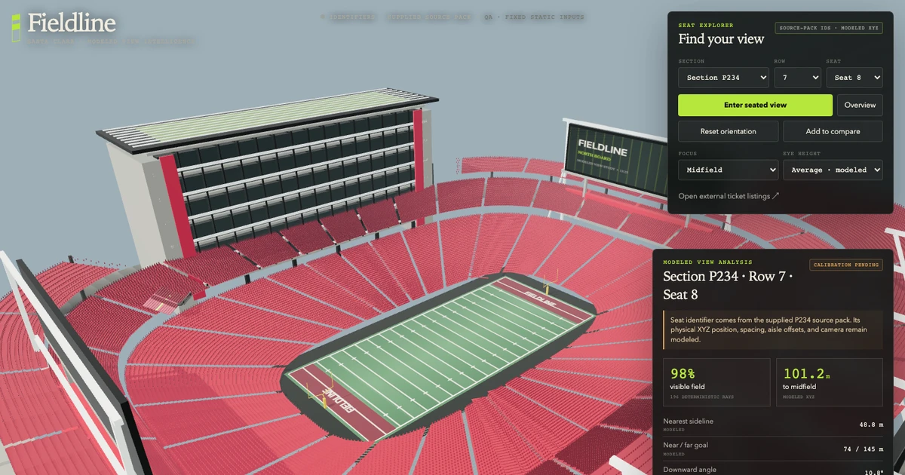</a>
    <h3>Fieldline Santa Clara</h3>
    <p><a href="https://github.com/mintdotgg/mint-playground/tree/main/experiences/fieldline-santa-clara">Code</a> · <a href="https://play.mint.gg/fieldline-santa-clara">Live demo</a></p>
  </td>
  <td valign="top">
    <p>Explore every section at Levi’s Stadium, enter modeled seated views, compare sightlines, and inspect obstruction, shade, weather, and event context before opening official tickets.</p>
    <p><sub>threejs · stadium · seat-preview · data-visualization · ticketing</sub></p>
  </td>
</tr>
<tr>
  <td width="220" valign="top">
    <a href="https://play.mint.gg/quadrotor-sandbox">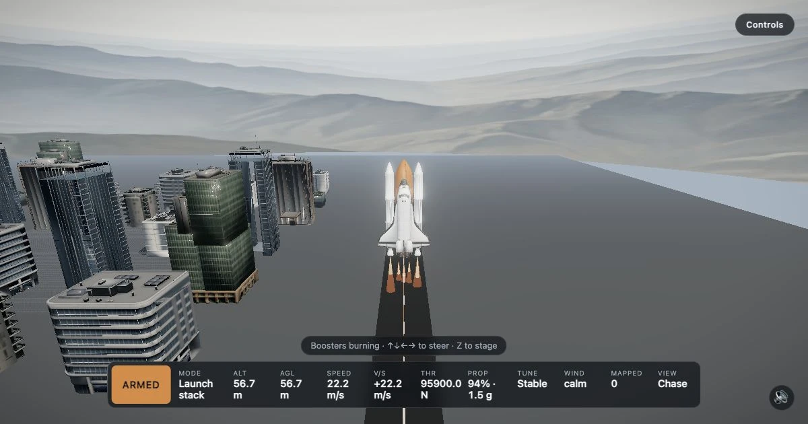</a>
    <h3>Quadrotor Sandbox</h3>
    <p><a href="https://github.com/mintdotgg/mint-playground/tree/main/experiences/quadrotor-sandbox">Code</a> · <a href="https://play.mint.gg/quadrotor-sandbox">Live demo</a></p>
  </td>
  <td valign="top">
    <p>Pilot seven distinct aircraft through a collider-rich city with real flight models, wind, sensing, tuning, landings, and launch staging.</p>
    <p><sub>threejs · flight-simulator · physics · vehicles · sandbox</sub></p>
  </td>
</tr>
<tr>
  <td width="220" valign="top">
    <a href="https://play.mint.gg/clicky">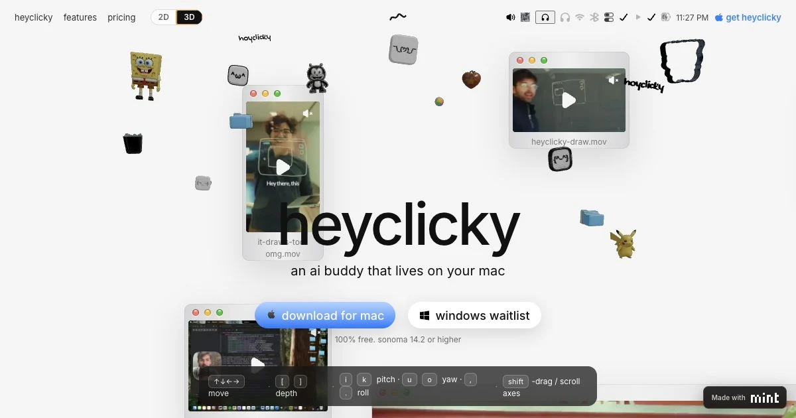</a>
    <h3>heyclicky</h3>
    <p><a href="https://github.com/mintdotgg/mint-playground/tree/main/experiences/clicky">Code</a> · <a href="https://play.mint.gg/clicky">Live demo</a></p>
  </td>
  <td valign="top">
    <p>Explore a playful desktop AI companion through draggable media windows, switchable 2D and 3D stickers, easter eggs, features, social proof, pricing, and FAQs.</p>
    <p><sub>react-three-fiber · ai-companion · 3d-stickers · interactive · product-site</sub></p>
  </td>
</tr>
</table>

## Quick start

Requirements: Node.js 20 or newer and pnpm 10.6.2. Corepack can install the
pinned pnpm version for you.

```bash
corepack enable
pnpm install --filter ./experiences/vanguard-protocol
pnpm play vanguard-protocol
```

Run `pnpm play` without a slug to choose an experience interactively, or use
`pnpm play --list` to print every available slug. Runtime 3D assets are loaded
from Mint CDN, so the experiences require a network connection.

To verify the repository catalog without installing dependencies:

```bash
pnpm validate:catalog
```

Build all experiences with `pnpm build`, or build one with:

```bash
pnpm --filter ./experiences/vanguard-protocol build
```

## Contributing

Bug fixes, accessibility improvements, performance work, tests, and clearer
documentation are welcome. Start with the [contribution guide](CONTRIBUTING.md)
and look for [`good first issue`](https://github.com/mintdotgg/mint-playground/labels/good%20first%20issue)
or [`help wanted`](https://github.com/mintdotgg/mint-playground/labels/help%20wanted)
issues. New experience ideas belong in the experience request form so the
maintainers can align them with the publishing pipeline before code is written.

If this collection saves you time or gives you an idea, star the repository to
follow future Playground drops. Maintainers can use the
[GitHub visibility playbook](docs/maintainer-playbook.md) for repository settings,
release structure, publishing checks, and weekly measurement.

## License

The source code is available under the [MIT License](./LICENSE). Mint-generated
runtime assets are loaded from Mint CDN and are not redistributed in this
repository.
