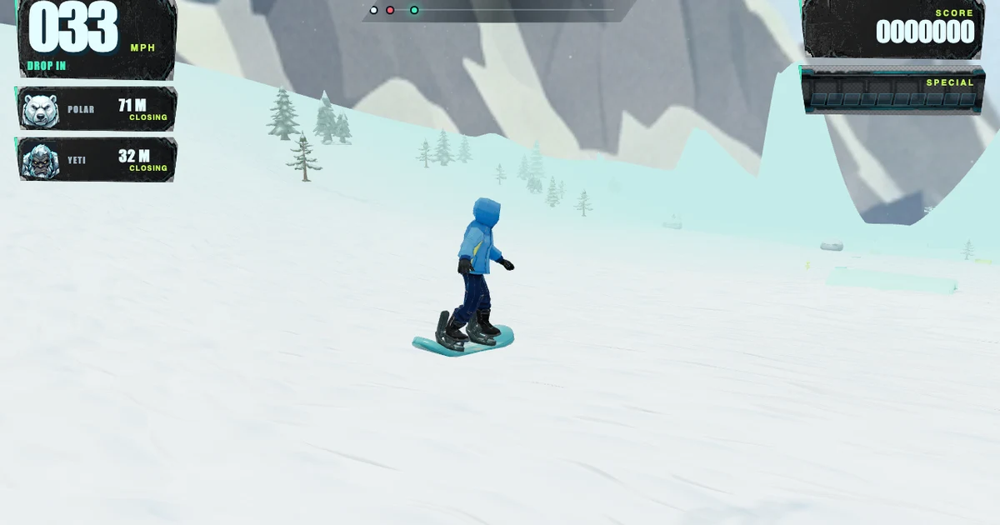

# Breakline

<a href="https://play.mint.gg/breakline">
  
</a>

Carve a 1.8 km mountain, chain tricks and grinds, and stay ahead of a Yeti and polar bear in a third-person arcade snowboarding chase.

[Live demo](https://play.mint.gg/breakline) · [Source code](https://github.com/mintdotgg/mint-playground/tree/main/experiences/breakline)

Made with [Mint MCP](https://mcp.mint.gg/) as the 3D asset pipeline and
[Mint Three.js Skills](https://github.com/mintdotgg/mint-threejs-skills) as the coding workflow.

## Run locally

From the `mint-playground` repository root:

```bash
pnpm install
pnpm --dir experiences/breakline dev
```
