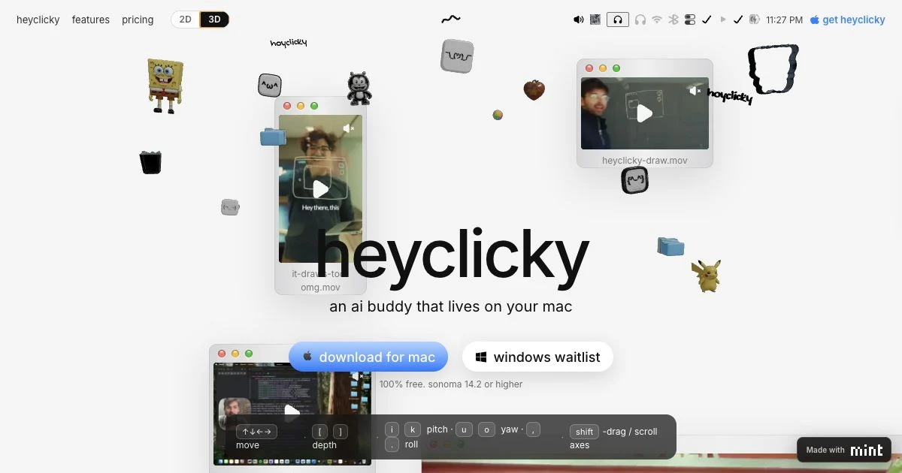

# heyclicky

<a href="https://play.mint.gg/clicky">
  
</a>

Explore a playful desktop AI companion through draggable media windows, switchable 2D and 3D stickers, easter eggs, features, social proof, pricing, and FAQs.

[Live demo](https://play.mint.gg/clicky) · [Source code](https://github.com/mintdotgg/mint-playground/tree/main/experiences/clicky)

Made with [Mint MCP](https://mcp.mint.gg/) as the 3D asset pipeline and
[Mint Three.js Skills](https://github.com/mintdotgg/mint-threejs-skills) as the coding workflow.

## Run locally

From the `mint-playground` repository root:

```bash
pnpm install
pnpm --dir experiences/clicky dev
```
