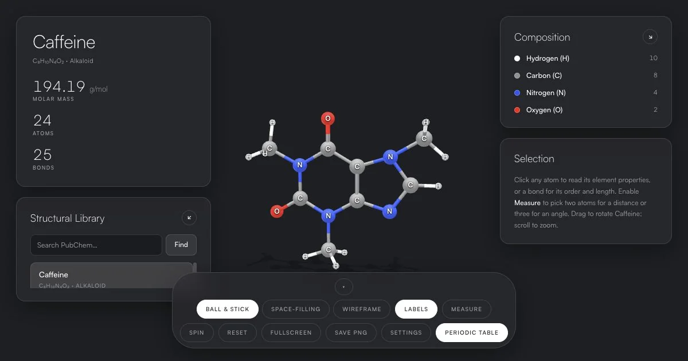

# Compound Visualization

<a href="https://play.mint.gg/compound-visualization">
  
</a>

Explore more than 40 molecules and crystals, switch rendering styles, inspect atoms and bonds, measure geometry, and search PubChem.

[Live demo](https://play.mint.gg/compound-visualization) · [Source code](https://github.com/mintdotgg/mint-playground/tree/main/experiences/compound-visualization)

Made with [Mint MCP](https://mcp.mint.gg/) as the 3D asset pipeline and
[Mint Three.js Skills](https://github.com/mintdotgg/mint-threejs-skills) as the coding workflow.

## Run locally

From the `mint-playground` repository root:

```bash
pnpm install
pnpm --dir experiences/compound-visualization dev
```
