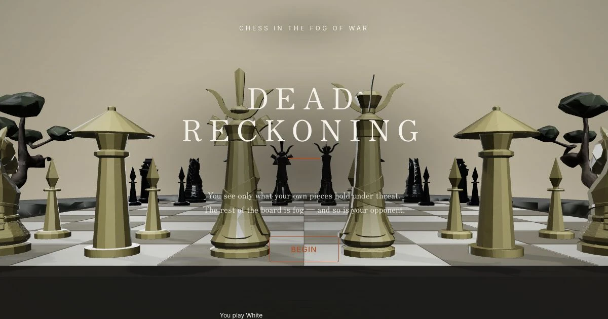

# Dead Reckoning

<a href="https://play.mint.gg/dead-reckoning">
  
</a>

Play a complete 3D chess match where fog reveals only squares your pieces attack while a greedy AI moves unseen.

[Live demo](https://play.mint.gg/dead-reckoning) · [Source code](https://github.com/mintdotgg/mint-playground/tree/main/experiences/dead-reckoning)

Made with [Mint MCP](https://mcp.mint.gg/) as the 3D asset pipeline and
[Mint Three.js Skills](https://github.com/mintdotgg/mint-threejs-skills) as the coding workflow.

## Run locally

From the `mint-playground` repository root:

```bash
pnpm install
pnpm --dir experiences/dead-reckoning dev
```
