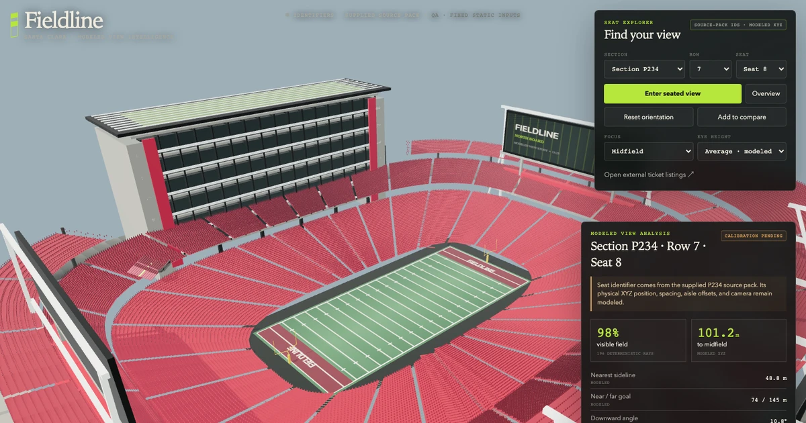

# Fieldline Santa Clara

<a href="https://play.mint.gg/fieldline-santa-clara">
  
</a>

Explore every section at Levi’s Stadium, enter modeled seated views, compare sightlines, and inspect obstruction, shade, weather, and event context before opening official tickets.

[Live demo](https://play.mint.gg/fieldline-santa-clara) · [Source code](https://github.com/mintdotgg/mint-playground/tree/main/experiences/fieldline-santa-clara)

Made with [Mint MCP](https://mcp.mint.gg/) as the 3D asset pipeline and
[Mint Three.js Skills](https://github.com/mintdotgg/mint-threejs-skills) as the coding workflow.

## Run locally

From the `mint-playground` repository root:

```bash
pnpm install
pnpm --dir experiences/fieldline-santa-clara dev
```
