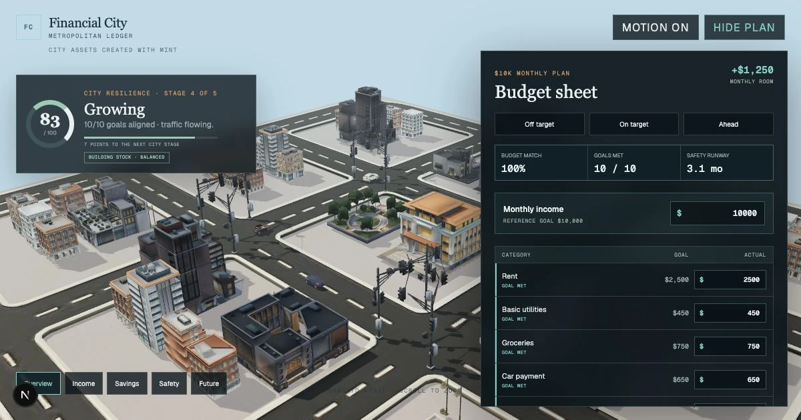

# Financial City

<a href="https://play.mint.gg/financial-city">
  
</a>

Shape a private monthly budget and watch traffic, civic services, construction pressure, and forty city blocks respond in a living miniature metropolis.

[Live demo](https://play.mint.gg/financial-city) · [Source code](https://github.com/mintdotgg/mint-playground/tree/main/experiences/financial-city)

Made with [Mint MCP](https://mcp.mint.gg/) as the 3D asset pipeline and
[Mint Three.js Skills](https://github.com/mintdotgg/mint-threejs-skills) as the coding workflow.

## Run locally

From the `mint-playground` repository root:

```bash
pnpm install
pnpm --dir experiences/financial-city dev
```
