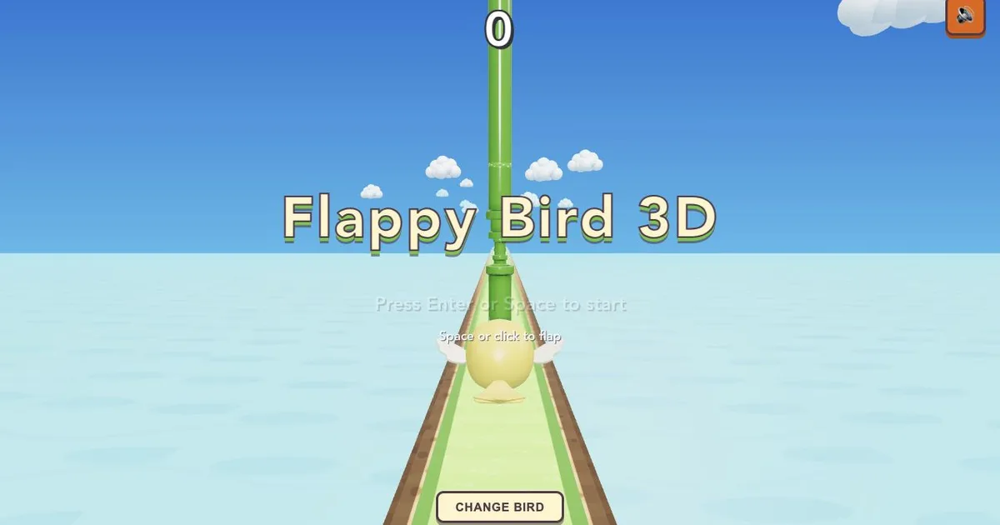

# Flappy Bird 3D

<a href="https://play.mint.gg/flappy-bird-3d">
  
</a>

Fly a selectable 3D bird down an endless ocean causeway, flapping through randomized pipe gaps for a high score.

[Live demo](https://play.mint.gg/flappy-bird-3d) · [Source code](https://github.com/mintdotgg/mint-playground/tree/main/experiences/flappy-bird-3d)

Made with [Mint MCP](https://mcp.mint.gg/) as the 3D asset pipeline and
[Mint Three.js Skills](https://github.com/mintdotgg/mint-threejs-skills) as the coding workflow.

## Run locally

From the `mint-playground` repository root:

```bash
pnpm install
pnpm --dir experiences/flappy-bird-3d dev
```
