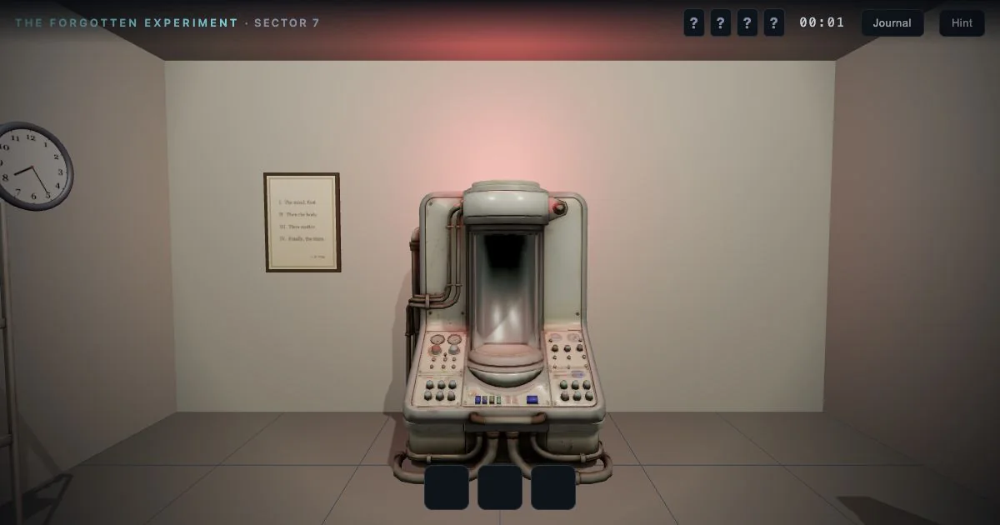

# The Forgotten Experiment

<a href="https://play.mint.gg/forgotten-experiment">
  
</a>

Search two abandoned laboratory rooms, collect and equip tools, solve layered evidence puzzles, and unlock Dr. Elias Vale&#39;s experiment.

[Live demo](https://play.mint.gg/forgotten-experiment) · [Source code](https://github.com/mintdotgg/mint-playground/tree/main/experiences/forgotten-experiment)

Made with [Mint MCP](https://mcp.mint.gg/) as the 3D asset pipeline and
[Mint Three.js Skills](https://github.com/mintdotgg/mint-threejs-skills) as the coding workflow.

## Run locally

From the `mint-playground` repository root:

```bash
pnpm install
pnpm --dir experiences/forgotten-experiment dev
```
