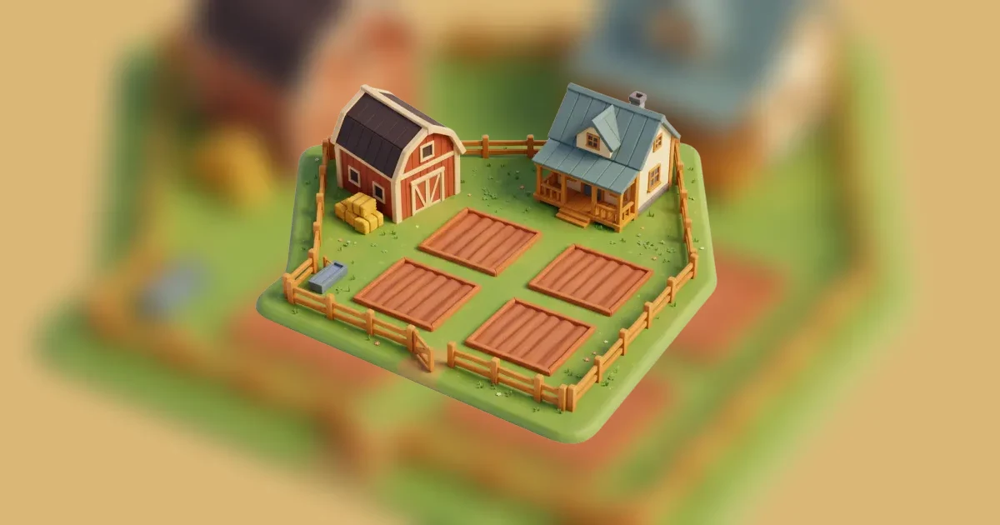

# Four Fields

<a href="https://play.mint.gg/four-fields">
  
</a>

Harvest corn, potatoes, tomatoes, and strawberries across four timed plots in a warm storybook miniature farm.

[Live demo](https://play.mint.gg/four-fields) · [Source code](https://github.com/mintdotgg/mint-playground/tree/main/experiences/four-fields)

Made with [Mint MCP](https://mcp.mint.gg/) as the 3D asset pipeline and
[Mint Three.js Skills](https://github.com/mintdotgg/mint-threejs-skills) as the coding workflow.

## Run locally

From the `mint-playground` repository root:

```bash
pnpm install
pnpm --dir experiences/four-fields dev
```
