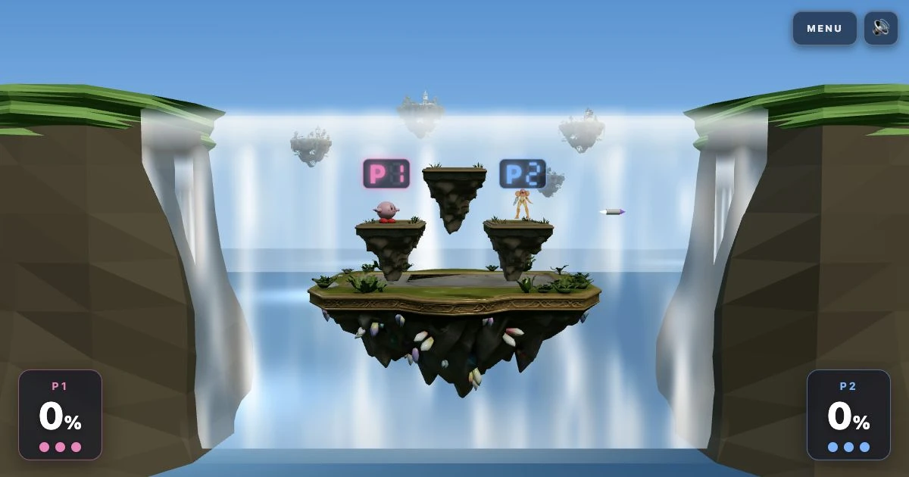

# Kirby Smash

<a href="https://play.mint.gg/kirby-smash">
  
</a>

Battle across three floating arenas in a 2.5D platform fighter with four selectable combatants, local two-player or CPU matches, percent damage, stocks, and Smash-style knockback.

[Live demo](https://play.mint.gg/kirby-smash) · [Source code](https://github.com/mintdotgg/mint-playground/tree/main/experiences/kirby-smash)

Made with [Mint MCP](https://mcp.mint.gg/) as the 3D asset pipeline and
[Mint Three.js Skills](https://github.com/mintdotgg/mint-threejs-skills) as the coding workflow.

## Run locally

From the `mint-playground` repository root:

```bash
pnpm install
pnpm --dir experiences/kirby-smash dev
```
