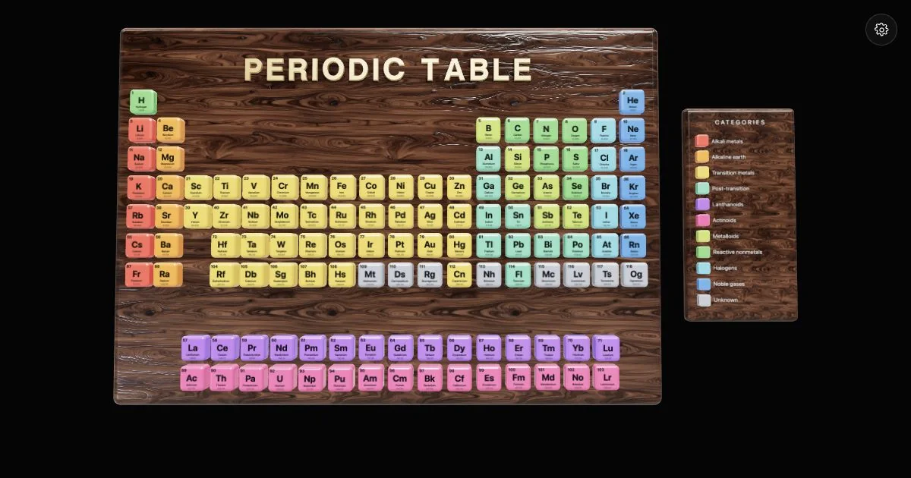

# Periodic Table 3D

<a href="https://play.mint.gg/periodic-table">
  
</a>

Browse all 118 elements on a tactile 3D table, open any tile, and orbit an animated atom surrounded by detailed scientific properties.

[Live demo](https://play.mint.gg/periodic-table) · [Source code](https://github.com/mintdotgg/mint-playground/tree/main/experiences/periodic-table)

Made with [Mint MCP](https://mcp.mint.gg/) as the 3D asset pipeline and
[Mint Three.js Skills](https://github.com/mintdotgg/mint-threejs-skills) as the coding workflow.

## Run locally

From the `mint-playground` repository root:

```bash
pnpm install
pnpm --dir experiences/periodic-table dev
```
