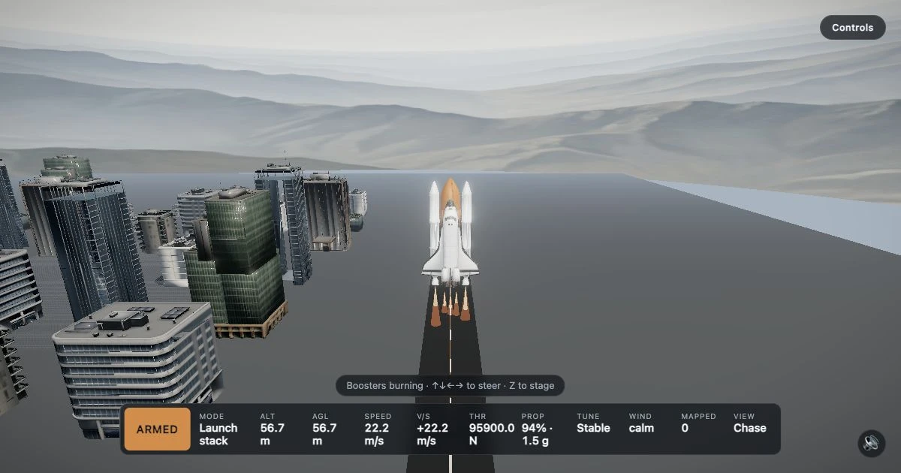

# Quadrotor Sandbox

<a href="https://play.mint.gg/quadrotor-sandbox">
  
</a>

Pilot seven distinct aircraft through a collider-rich city with real flight models, wind, sensing, tuning, landings, and launch staging.

[Live demo](https://play.mint.gg/quadrotor-sandbox) · [Source code](https://github.com/mintdotgg/mint-playground/tree/main/experiences/quadrotor-sandbox)

Made with [Mint MCP](https://mcp.mint.gg/) as the 3D asset pipeline and
[Mint Three.js Skills](https://github.com/mintdotgg/mint-threejs-skills) as the coding workflow.

## Run locally

From the `mint-playground` repository root:

```bash
pnpm install
pnpm --dir experiences/quadrotor-sandbox dev
```
