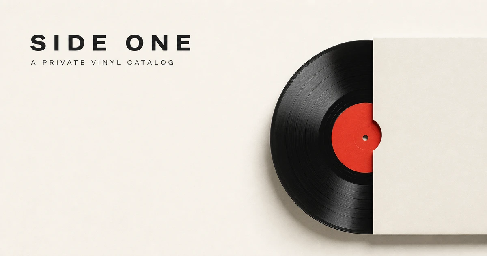

# Side One

<a href="https://play.mint.gg/side-one">
  
</a>

Browse seven landmark releases across nine pressings, inspect every sleeve and track list, and cue a record on a configurable 3D turntable.

[Live demo](https://play.mint.gg/side-one) · [Source code](https://github.com/mintdotgg/mint-playground/tree/main/experiences/side-one)

Made with [Mint MCP](https://mcp.mint.gg/) as the 3D asset pipeline and
[Mint Three.js Skills](https://github.com/mintdotgg/mint-threejs-skills) as the coding workflow.

## Run locally

From the `mint-playground` repository root:

```bash
pnpm install
pnpm --dir experiences/side-one dev
```
