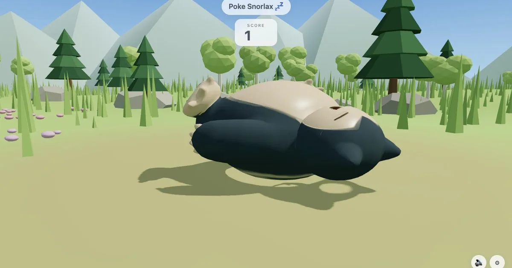

# Sleeping Snorlax

<a href="https://play.mint.gg/sleeping-snorlax">
  
</a>

Poke a peacefully sleeping Snorlax to trigger escalating procedural reactions, combos, wake-ups, and permanent growth.

[Live demo](https://play.mint.gg/sleeping-snorlax) · [Source code](https://github.com/mintdotgg/mint-playground/tree/main/experiences/sleeping-snorlax)

Made with [Mint MCP](https://mcp.mint.gg/) as the 3D asset pipeline and
[Mint Three.js Skills](https://github.com/mintdotgg/mint-threejs-skills) as the coding workflow.

## Run locally

From the `mint-playground` repository root:

```bash
pnpm install
pnpm --dir experiences/sleeping-snorlax dev
```
